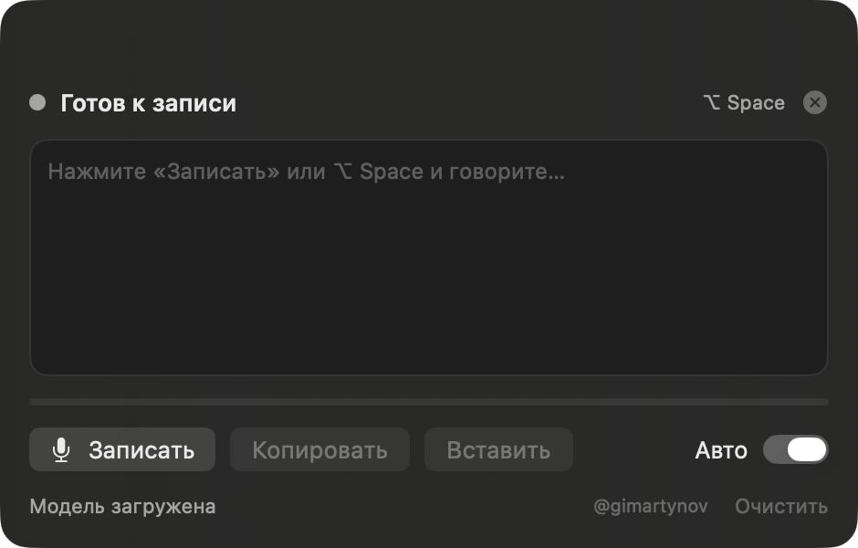

# Whisper Dictation

Local voice dictation for macOS. Press a shortcut, speak, and the text is
inserted into the app you were using — Telegram, Notes, a browser, anything.
Everything runs on-device via [whisper.cpp](https://github.com/ggerganov/whisper.cpp);
no audio leaves the Mac.



## Features

- **Global hotkey** `⌥ Space` starts and stops recording, no matter which app is focused.
- **Floating panel** that never steals keyboard focus: live recording indicator,
  recognized text, `Copy`, `Paste`, `Clear`.
- **Auto-insert** into the previously active app via clipboard + `⌘V`.
- **Menu bar only** — no Dock icon, no windows on launch except the panel.
- **Local model**, downloaded once into `~/Library/Application Support/WhisperDictation/models`
  and verified with SHA-256 after download.
- Russian by default. The Whisper model supports other languages, but the
  app currently passes `-l ru` and has no language picker.

## Requirements

- Apple Silicon Mac (M1/M2/M3/M4). Intel is not supported.
- macOS 14 Sonoma or later.
- ~1.7 GB of free disk space for the model.
- Internet only for the first model download.

## Install (prebuilt)

1. Download `WhisperDictation.dmg` from Releases.
2. Open it and drag `WhisperDictation.app` to `/Applications`.
3. First launch: right-click the app in Finder → **Open** → **Open**.
   If the “Open” button is missing (macOS 15+), use
   **System Settings → Privacy & Security → Open Anyway**.
4. The panel appears in the bottom-right corner. If not, click the waveform
   icon in the menu bar.
5. Press **Download 1.6 GB** and wait for the model.
6. Allow microphone access when asked.
7. For auto-insert: **System Settings → Privacy & Security → Accessibility → +**
   → add `WhisperDictation.app` → toggle on → restart the app.

Usage: put the cursor where you want text, press `⌥ Space`, speak, press
`⌥ Space` again. With **Auto** enabled the text is pasted automatically.

## Build from source

macOS 14+, Xcode command line tools, Homebrew with `whisper-cpp`, `ggml`, `libomp`.

```bash
./build.sh      # builds build/WhisperDictation.app
./make-dmg.sh   # builds build/WhisperDictation.dmg
```

The app is ad-hoc signed (no Apple Developer certificate). The bundle embeds
`whisper-server`, its dylibs and ggml backends, so the target Mac does not need
Homebrew.

During development you can point the app at an existing model file instead of
downloading it:

```bash
WD_DEV_MODEL=/path/to/ggml-large-v3-turbo.bin ./build/WhisperDictation.app/Contents/MacOS/WhisperDictation
```

## How it works

`AVAudioEngine` records 16 kHz mono PCM into a temporary WAV, the app POSTs it to
a bundled `whisper-server` on `127.0.0.1:25400`, and the recognized text goes to
the clipboard followed by a synthesized `⌘V` into the previously focused app.
The global hotkey is registered through Carbon `RegisterEventHotKey`.

```
Sources/WhisperDictation/
  main.swift          app bootstrap
  AppDelegate.swift   menu bar, panel, recording flow
  AppModel.swift      observable state
  AudioRecorder.swift AVAudioEngine → WAV
  WhisperEngine.swift whisper-server lifecycle + HTTP
  ModelDownloader.swift  model download with progress
  HotkeyManager.swift global ⌥ Space
  TextInserter.swift  clipboard + ⌘V
  PanelView.swift     SwiftUI panel
```

## Privacy

- Audio is written to a temporary file, sent to the bundled whisper.cpp server on
  `127.0.0.1` (loopback only), and deleted after transcription.
- No analytics, no telemetry. The only network request is the one-time model
  download from Hugging Face (which exposes your IP, as any download does).
- Auto-insert uses the system clipboard; the previous clipboard content (all
  items, not just text) is restored after pasting.
- See [PRIVACY.md](PRIVACY.md).

## Disclaimer

Recognition may contain errors. Check the text before sending or using it.
Do not rely on it for medical, legal, financial, or emergency purposes without
human review.

Whisper Dictation is not affiliated with, endorsed by, or sponsored by OpenAI.
"Whisper" refers to OpenAI's open-source speech recognition model, used under
the MIT license.

## Known limitations

- Ad-hoc signing: Gatekeeper requires the “Open Anyway” step. Download only from
  the official Releases page and verify the published SHA-256 of the DMG.
- On a Mac with Homebrew's `ggml`, the whisper server may load ggml backends
  from Homebrew instead of the bundled ones. Without Homebrew the bundled
  backends are used.
- The model download has no resume; if interrupted it starts over.
- A recording can be transcribed only while the model is loaded; first run takes
  a few seconds to warm up.
- No auto-start at login.

## Third-party components

- whisper.cpp — MIT
- ggml — MIT
- LLVM OpenMP runtime — Apache 2.0 with LLVM Exceptions

Full texts are in `Resources/licenses/` and inside the app bundle. See
`THIRD-PARTY-NOTICES.txt`.

## License

MIT — see [LICENSE](LICENSE).

---

# Whisper Dictation (по-русски)

Локальная диктовка для macOS: нажимаете `⌥ Space`, говорите, текст сам
вставляется в активное приложение. Всё распознавание идёт на Mac через
whisper.cpp, аудио никуда не отправляется.

**Требования:** Apple Silicon, macOS 14+, ~1,7 ГБ на модель.

**Важно:** распознавание может ошибаться — проверяйте текст перед отправкой.
Приложение не связано с OpenAI; «Whisper» — открытая модель OpenAI под лицензией MIT.

**Установка:** открыть DMG, перетащить приложение в «Программы», первый запуск
через правый клик → «Открыть», скачать модель 1,6 ГБ, разрешить микрофон и
«Универсальный доступ» (для автовставки). Подробнее — в `Установка.txt` внутри DMG.

**Сборка:** `./build.sh`, затем `./make-dmg.sh` (нужен Homebrew с whisper-cpp).

**Лицензия:** MIT, сторонние компоненты — whisper.cpp и ggml (MIT), libomp
(Apache 2.0 с LLVM-исключением).
